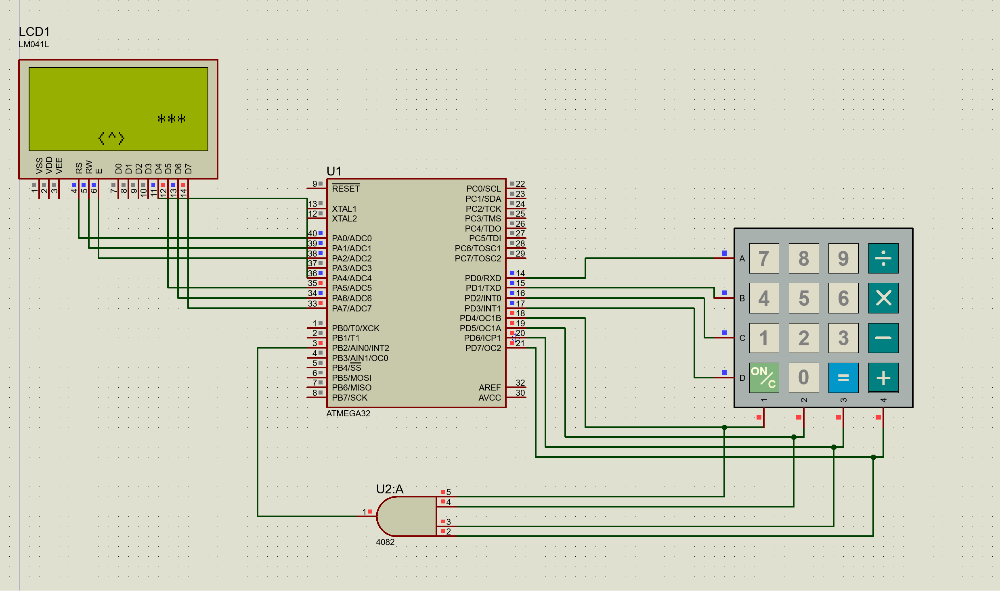

# AVR_Obstacle_Dodge


A small obstacle-dodging game for AVR microcontrollers, played on a 16×2 alphanumeric LCD with a 4×4 matrix keypad. The player moves left or right to avoid falling obstacles.



## Features

- 16×2 alphanumeric LCD as the game field
- 4×4 matrix keypad for left / right movement
- Randomised falling obstacles with collision detection
- ATmega32 target (port pins configurable in the CodeVision wizard)
- Runs fully in simulation (Proteus + CodeVisionAVR)

## Controls

| Key | Action |
| --- | --- |
| `4` / `←` | Move left |
| `6` / `→` | Move right |

The player is drawn as `#`, obstacles as `*`. On collision the game stops and prints `Game Over`.

## Build and simulate

### CodeVisionAVR

1. Open `AVR_Obstacle_Dodge.c` in CodeVisionAVR.
2. Enable the LCD library: *Project → Configure → CodeWizardAVR → Alphanumeric LCD*.
3. Set the LCD port and pins (e.g. `PORTC`).
4. Compile — the `.hex` and `.cof` files are generated.

### Proteus

1. Create a project with an **ATmega32**, a **16×2 LCD** and a **4×4 keypad**.
2. Wire them to the same ports used in the CodeVision configuration.
3. Load the compiled `.hex` into the ATmega32 and start the simulation.

> Tip: assign Proteus buttons to keypad rows to play with the mouse.

## Project files

```
AVR_Obstacle_Dodge.c        # game logic
AVR_Obstacle_Dodge.cproj    # CodeVisionAVR project
AVR_Obstacle_Dodge.pdsprj   # Proteus schematic
images/                     # setup screenshot
LICENSE.txt                 # MIT
```

## License

MIT — see [LICENSE.txt](LICENSE.txt). © Mostafa Ahmadi
